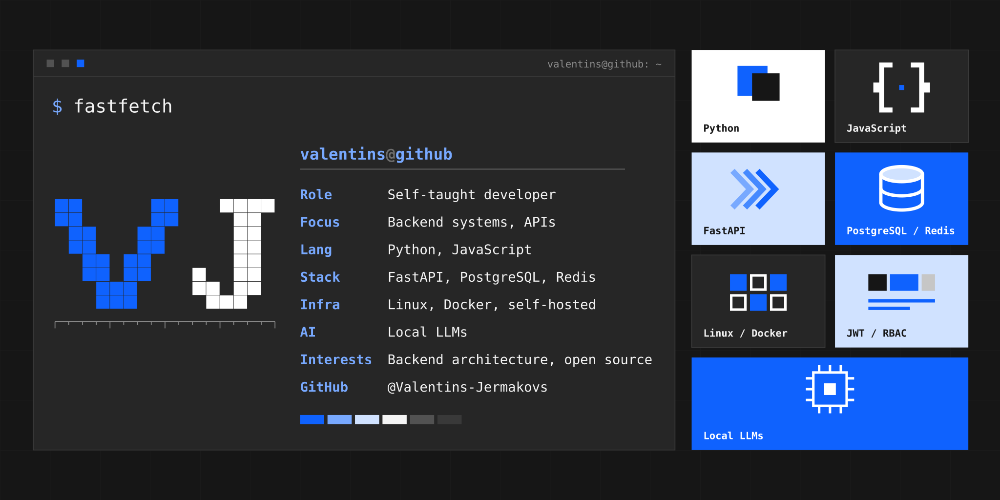

  

# Valentins Jermakovs

Self-taught developer. I build backend systems and APIs, and I run them on infrastructure I host myself.

## Focus

- Design and build backend systems and APIs.
- Secure access with JWT and role-based access control (RBAC).
- Run language models locally.

## Technology

| Area | Tools |
| :--- | :--- |
| Languages | Python, JavaScript |
| Framework | FastAPI |
| Data | PostgreSQL, Redis |
| Infrastructure | Linux, Docker, self-hosted services |
| Security | JWT, RBAC |
| AI | Local LLMs |

## Interests

- Backend architecture
- Open source

## Contact

GitHub: [@Valentins-Jermakovs](https://github.com/Valentins-Jermakovs)